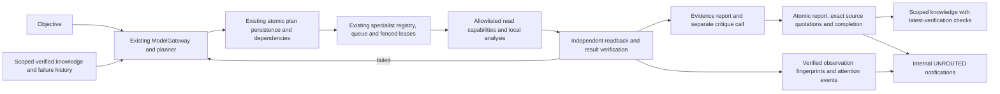

# Phase 4 integration candidate

Baseline: `14b24a9ff51cb98de400e197bf2bfad40de96812` on PR #46. Candidate branch:
`codex/sam-phase4-integration`. No feature branch was merged, rebased or changed;
PR #46 and main retain their original heads. This is a selective integration
candidate for independent review, not authorization to merge or deploy.

## Architecture and dependency map



Existing core services remain the execution engine. No second executive, queue,
worker lease system, operation ledger, model gateway or notification transport
was introduced. `apps/integration/src/composition.ts` explicitly combines existing
production composition with the reviewed read-report, perception and notification
modules. It requires restricted LOGIN admission, immutable feature policies,
GREEN tools with `sideEffect=false`, and exactly one matching company per tool
and capability. It is not registered by production/default bundle loading.

The synthetic staging composition is an awaited Promise module using the existing
runtime entrypoint. It exposes only the existing local arithmetic bundle, with
no model or provider adapter. It requires the explicitly selected profile and
fixed principal before HTTP opens. NEW natural-language goals have no planner in
that profile; it must not be presented as autonomous staging execution.

Selected existing modules came from the frozen cumulative cloud branch
`583f71db38c9d9f6231f25d96e3a2a1be429463c`. The
[import manifest](phase4/import-provenance.json) records original path, SHA and
SHA256 for each imported module/migration. Adaptations are reviewable in the
candidate diff. The existing Node/pg/tsx/MCP package versions and lockfile are
retained. Old branch dependencies on another MCP SDK layout, AJV or PGlite were
not imported. Integration acceptance uses real PostgreSQL and the installed core
validator; unsupported remote schema keywords fail closed at discovery.

## Branch inventory and conflict resolutions

[Frozen remote refs](phase4/remote-refs-before.json) contain 110 actual remote
heads. [The branch matrix](phase4/branch-matrix.json) records all 51 heads not
ancestral to the core candidate, their SHAs, merge bases, migrations, dependency
differences and exact direct-merge conflict paths. Historical phase branches
already ancestral to the baseline are preserved and excluded from divergent work.
Native Git was used; no combined feature branch was executed wholesale.

| Work | Frozen SHA prefix | Direct merge conflicts against core | Candidate decision |
| --- | --- | ---: | --- |
| MCP internal OAuth design | `66188db` | 5 | Reuse standalone contract/store implementation; remove service-bearer password fallback; no HTTP registration |
| Google read/review foundation, despite perception branch name | `af4be2e` | 27 | Reuse PKCE, durable encrypted store, seven-tool bridge, evidence and read-report modules; keep live routes/adapters disconnected |
| Scoped knowledge | `cacc3a0` | 30 | Add scoped source quotations and planner recall; reject revoked verification on recall and unsupported provenance on INSERT |
| Research | `a3c5977` | 31 | Add bounded research contracts, untrusted-source envelopes and operator-allowlisted MCP adapter; retain core validator/deadlines |
| Actual perception/notifications in cumulative cloud work | `583f71d` | 32 | Explicit profile only; reuse fingerprints/projector; fence child tables, preserve leases/outbox ownership and canonical `tool:` ledger keys |
| Commercial learning | `8e79f25` | 30 | Deferred; numbering overlaps and broader experimental/commercial scope need separate acceptance |
| Earlier owner notification branch | `a95d084` | 27 | Do not also import its alternate `00103` migration/projector |

The perception-named branch at `af4be2e` ends at 00101 and does not contain actual
00104 monitor tables. OSS provider/search/inbox branches add alternate transport,
action and routing surfaces; their inventory/conflicts are retained, but those
surfaces are not activated. Google staging and supplier adapter branches remain
separate. Deployment and protected stability branches are never integration inputs.

Resolution details:

- **Planner and workers:** retain core reservation/deadline/backoff, DAG/result
  references, lease budgets, failure containment and current-plan checks. Add
  conditional research/knowledge hooks instead of replacing them with older code.
- **Transactions:** extract the existing plan persistence body into a shared
  transaction-taking function. The public atomic API remains a wrapper around
  that same body; report continuation can reuse it without a nested transaction.
- **Completion:** only explicitly opted-in `sam.read_report.v1` goals remain in
  VERIFYING after all work verifies. Report, quotations and completion commit
  together after citation/schema validation and a separate critique call. Ordinary
  core acceptance behavior remains unchanged.
- **Failure history:** latest failed verification excludes an execution from
  report sources. Failed old plans remain control history, enabling a successful
  revised plan to complete without promoting its failed predecessor into evidence.
- **Permissions:** ordinary core provisioning is unchanged. The new operator-only
  feature provisioner adds fixed restrictive role policies plus parent-scoped
  fences on report, perception and notification child tables. It grants no token
  store, delivery attempt, capability-configuration or DDL access. Notifications
  require operator-seeded settings rather than runtime self-enablement.
- **Learning:** this profile admits SOURCE_FACT quotations only, with an invoker
  trigger checking same goal/entity, latest VERIFIED evidence and literal source
  content. It does not promote model paraphrases, inferences or owner decisions.
- **Actions:** the existing executor/approval/operation ledger is retained. The
  feature policy's `action:` key becomes the core `tool:` key; the candidate
  composition refuses all side-effect tools regardless of approval or remote hints.
- **MCP runtime evidence:** the release test-results tool no longer reads an
  archived summary absent from the runtime image or treats its historical PASS
  as current acceptance. It returns NOT_RUN with an explicit external-report
  classification. The image restart test makes authenticated MCP tool calls,
  asserting real loopback service health and honest missing-attestation status.

## Migration compatibility

The default directory and its twelve reviewed migrations remain byte-identical to
core. All core tests and the managed-schema count/hash guard retain their original
scope. Eight unmodified feature SQL files live in a separate opt-in directory:
00011, 00099, 00100, 00101, 00102, 00103, 00104 and 00105. The operator API records
their checksums in a separate ledger, applies the batch atomically and refuses
changed receipts. It is not an application startup hook.

Acceptance tests prove both a core-12 database upgraded with feature-8 (including
late 00011 after 00013) and a fresh globally sorted twenty-file schema through the
actual core migrator. Column parity, pre-upgrade sentinel retention, repeat apply
and checksum rejection are asserted. Default core rollback/restart tests still run.

Distinct branches use `00103_owner_notifications` versus
`00103_research_mcp_verification`, and `00105_commercial_learning` versus
`00105_owner_notifications`. These are numbering/order overlaps, not evidence that
their SQL necessarily cannot coexist. This candidate chooses the cumulative
cloud sequence; alternate combinations were not accepted. Do not rename an
already-applied migration or infer which unmerged migrations exist on a remote
database. No remote migration history was accessed.

## What multi-agent acceptance actually proves

The scenario invokes the actual ModelGateway and planner against a synthetic
business objective. A mock provider proposes an initial plan whose independent
verification fails. The real replanner receives that failure, persists a revised
dependency graph, and delegates source research and analysis to distinct specialist
identities. A source specialist throws once; durable lease recovery retries it.
The dependent analyst runs only after verified source data propagates through the
existing typed result-reference mechanism.

The real report engine makes report and critique calls, validates runtime-copied
source-line citations and commits exactly one final report with two verified
quotations. New-process recall proves persistence; newer FAILED verifications
remove those quotations from recall. Same-org sibling and other-org goals remain
invisible. Missing/spoofed context, token/delivery access, binding mutation,
side-effect tools, provider misbinding and missing immutable policy are refused.

Perception processes a verified baseline and then a changed synthetic source
version executed through the existing queue and verifier. It emits an attention
event and exactly one UNROUTED review notification. Repeated projection creates
no duplicate and leaves outbox status untouched. No send/delivery function runs.

**Limits:** all model, critique and upstream-source responses are test doubles.
This is real orchestration under synthetic contracts, not proof of natural-language
understanding, live autonomous research or specialist reasoning. Specialist agents
currently execute registered capabilities; independently reasoning specialist
models are **NOT IMPLEMENTED**. A separate critique call through one mock adapter
is not independent cognitive review. Current memory proves verified retrieval,
not that a business assertion is true or that SAM improved a policy through learning.

## Independent acceptance and retained evidence

```sh
git checkout codex/sam-phase4-integration
npm run verify:full
```

The original 35 required stages remain and three integration stages are added:
migrations, OAuth/MCP and orchestration. Four Compose specifications are validated
without interpolation or secret-file resolution; none is started by that check.
Every required stage must pass against the exact committed candidate. The runner
retains commands, individual suite results, timestamps, image IDs, source hashes
and failed/NOT_RUN outcomes. Artifacts remain under `.local/verification/`.

Development diagnostics are separate from clean-candidate acceptance. Initial
TypeScript adaptation errors (the research string predicate and old branch API
names) were corrected without weakening checks. Focused runs and any full-run
failures must be retained alongside the eventual successful report. This document
does not label an unexecuted full candidate as accepted; use the generated report
for its exact source SHA and verdict.

## Governance, integration order and remaining gates

[Authorized/public observations](phase4/github-governance.json) confirm PR #46 is
DRAFT at 14b24a9, base main. This task does not modify it. Public main metadata says
no classic branch protection/merge queue; API protection access remains Forbidden.
Effective inherited rulesets, required checks and approval counts remain
**UNVERIFIED**. Therefore a future independently approved merge cannot yet be
declared permissible. Obtain those effective rules through the existing authorized
integration; satisfy them as configured. No fake green statuses or check disabling.
The previously confirmed GitHub account-admission restriction remains documented;
no billing or Actions endpoint is used for this candidate's verification.

Recommended coherent integration order: core PR #46 → OAuth/provider identity
contracts → Google read/review foundation → knowledge → research → perception
observation/policy → internal notifications → separately reviewed OSS/action or
commercial experiments. This describes dependency order for selective reviewed
changes, not instructions to merge cumulative branches wholesale.

Remaining security/reliability gates:

1. Independent reviewer acceptance and effective repository governance; no merge
   is authorized here even if local tests pass.
2. Live OAuth HTTP wiring, issuer/client/account-to-company binding, narrowly
   scoped test consent and token-role isolation are not validated live. Imported
   auth stores remain inaccessible to runtime workers and disconnected from HTTP.
3. No live source/model evaluation, independent specialist reasoning or natural-
   language performance evidence. Research budget contracts and deterministic
   citation checks cannot establish semantic correctness of a report.
4. SOURCE_FACT recall reacts to verification revocation; historical reports and
   already-projected notifications are not automatically rewritten/retracted.
5. Profile ACLs assume trusted application code and operator-reviewed parent
   policies; they do not implement a separate database approver/verifier trust
   domain. No side-effect profile or message delivery is accepted.
6. Staging secrets, server identity/TLS, certificate/key ownership, backups,
   measured restore/RPO/RTO, capacity and an observation window need approved
   resources and separately authorized execution. No remote state was inspected.

Verdict: a feasible isolated integration candidate exists, subject to the exact
independent acceptance report and review. Synthetic staging configuration is
prepared for an authorized rehearsal. Live connector/autonomous staging and
production readiness remain **NOT ESTABLISHED**.
