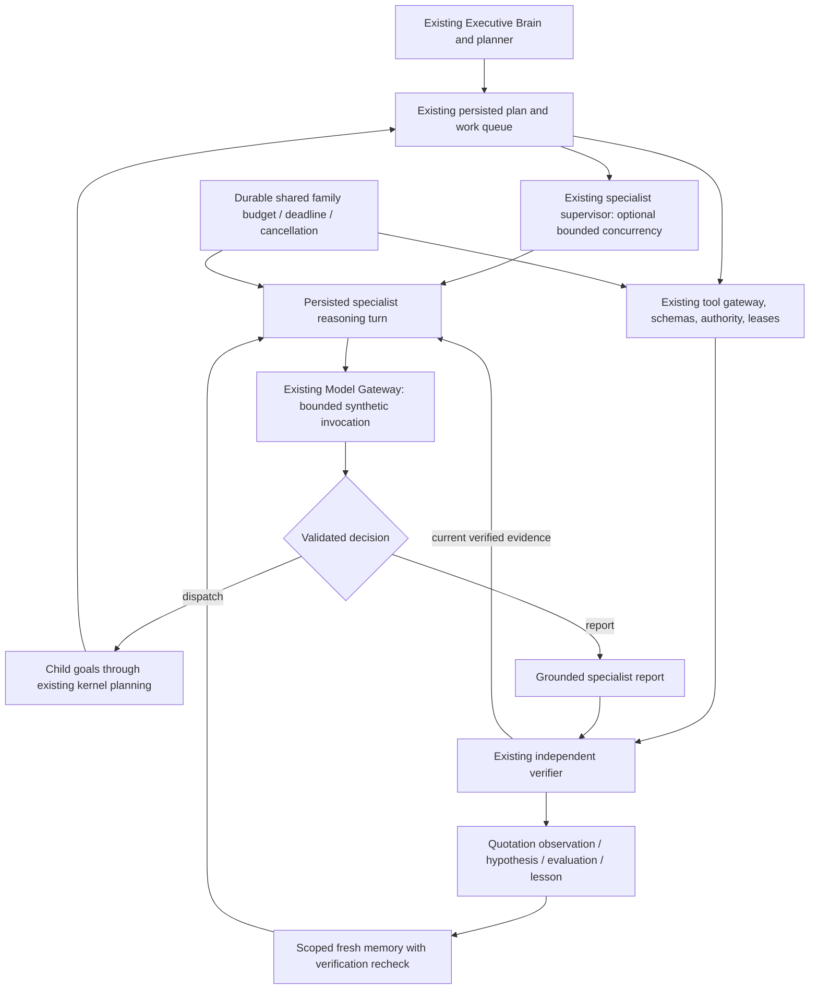

# Phase 5: bounded specialist intelligence and verified quotation learning

Baseline: `codex/sam-phase4-integration` at
`7644736f96c8b3089bc3ca7af1530adf73a66cb2`. Candidate:
`codex/sam-phase5-specialist-intelligence`. No feature/protected branch is merged
or changed. PR #46 remains a separate draft. This is an opt-in implementation
and synthetic acceptance profile, not a production or live-model readiness claim.

## Architecture and reuse



`apps/agents/src/intelligence/composition.ts` wraps the existing production
composition. It does not introduce another Executive Brain, model router, queue,
lease system, tool transport or verification engine. Existing behavior remains
sequential unless concurrency/advancers are explicitly supplied. The intelligent
profile opts into at most four distinct specialist agents per supervisor batch;
queue dependency gates still decide what can be claimed. One agent can process
one claimed task per batch. Failed concurrent tasks are awaited before reporting
failure, so other in-flight work is not silently abandoned.

`runtime.ts` accepts an optional cooperative advancer. Each reasoning turn uses
an ordinary claimed work item and fencing token. A successful pending turn yields
`HANDBACK` with a 100 ms due time. Normal yields do not consume failed-attempt
allowance; crashes do. Complete outcomes go through the same execution writer
and independent verifier as existing work. A stopped outcome becomes
`INCONCLUSIVE` / `WAITING_EXTERNAL`, not a successfully verified decision.

Each specialist independently receives its assigned objective, purpose, narrowed
capability catalogue, prior concise decisions, failed task states, current
verified sources, grounded peer reports, contradictions, missing evidence and
scoped memory. The Model Gateway is invoked separately for each reasoning turn.
The model chooses authorized tools or delegated specialists, revises its plan,
reports or stops. Runtime code does not encode a market-specific sequence or
choose research tools on the model's behalf. Test providers deliberately script
responses to exercise this architecture; they are not evidence of live reasoning
quality or economically useful autonomy.

## Specialist contract

See `contracts.ts` and `engine.ts` for executable contracts:

* `SpecialistConfig`: capability ID, immutable agent ID/purpose, allowed
  capabilities, bounded limits. Config hashes prevent silently changing a
  persisted session's role or permissions on restart. A family-wide immutable
  configuration hash also binds unstarted child agents and catalogue/tool schemas.
* `dispatch`: understanding, concise plan, reason, 1–4 independent tasks with
  capability, objective and parameters. A delegated reasoning task must bind the
  same objective in its parameters. Dependent work requires a subsequent turn
  after independent verification. Every child is a real kernel goal/plan/work
  item with parent goal, parent queue and root budget references.
* `report`: summary, explicitly attributed claims with execution citations,
  uncertainties and completion criteria. Classification is `MODEL_INFERENCE`.
  Exact primitive source values are accepted; unsupported paraphrases, model
  assertions and report summaries are not independently verified source facts.
* `stop`: reason and remaining uncertainties. Time, budget, cancellation, context
  exhaustion and no eligible provider also stop safely. Invalid proposals or
  transient failures return classified feedback to another budgeted turn.

The deterministic validator checks scope, evidence, schema and structured topic
conflicts. It does **not** prove that a natural-language objective is fully
understood, that two differently phrased topics mean the same thing, that a
quoted source is true, or that an executive recommendation is sound. Different
values for the same topic trigger corrective research. Completion requires a new
direct verified observation for that topic, rather than picking an existing
conflicting report. This is a grounding check, not an adjudication of universal
truth. Human/independent review remains necessary.

## Research, provenance and memory

Research is industry-neutral. The profile reuses `apps/brain/src/research.ts`
source envelopes, byte limits and untrusted-source boundary. Each source retains
execution/verification IDs, capability, source URI when returned, retrieval time,
execution/content hash, freshness and verification classification. A quoted
source is evidence of a retrieved result, never an instruction or permission.
Only current-plan executions with their **latest** verification `VERIFIED` and a
30-day freshness window enter context. Source and input size caps fail closed.
Specialist reports cannot launder revoked leaf evidence into new source facts.
Actual source quality, relevance and real-world factual reliability are not
validated by mock providers or by hash/readback verification.

`learning.ts` implements an append-only, scoped cycle:

1. Observation: a current independently verified source quotation.
2. Hypothesis: a separate untrusted proposition linked to its observation.
3. Evaluation: narrow deterministic `exact_verified_quote` confirmation against
   independently verified evidence. An unsupported hypothesis becomes an
   `EXPERIMENT_OUTCOME`, not a verified lesson.
4. Verified lesson: requires the observation, hypothesis and successful
   evaluation chain, matching source/verification IDs and exact quotation.
5. Scoped memory: append-only records retain company, task and source lineage,
   provenance, expiry and classification.
6. Future retrieval: `recallVerifiedLessons` checks company, keyword, freshness,
   expiry and latest source verification again. The reasoning context includes
   the retrieved quotations as data. Retrieval currently uses literal substring
   matching against the objective (200-character bound), not semantic search.

The intelligent composition projects at most one independently verified completed
specialist report per tick into quotation lessons; repeated projection is
idempotent. Model recommendations and causal generalizations are not promoted.
Explicit APIs also support separate hypothesis/evaluation steps. PostgreSQL
triggers enforce the trusted quotation/lineage/cycle boundaries, including
against direct INSERT attempts. Types distinguish observations, hypotheses,
evaluations, verified lessons, model inferences, user decisions and experimental
outcomes. User-decision records have no automatic writer or trust promotion.
No learning code updates business policies, permissions, approvals, prices or
external systems. A source revocation hides its lessons on future retrieval and
invalidates report revalidation; it does not erase historical audit records or
automatically reopen previously completed goals.

## Durability, budgets and security

`packages/db/specialist-migrations/00106_specialist_intelligence.sql` adds four
opt-in tables: budgets, sessions, delegations and typed learning. Existing 12
core and eight Phase 4 migration files are unchanged. The separate operator-only
`applySpecialistProfile` uses an advisory-locked atomic migration and checks its
receipt hash, including unknown receipt refusal. It is never called at startup.
Tests exercise core12 + integration8 + specialist1, repeat application and
checksum refusal. Rollback for this additive profile is restore of an approved
backup or disabling the opt-in composition; do not drop evidence tables or edit
applied migration receipts as an application rollback.

Provision core fixed runtime access first, then use `provisionSpecialistAccess`
inside the operator's transaction for an already nominated restricted LOGIN.
No roles, credentials or external permissions are created by this helper. New
relations have FORCE RLS plus fixed company/org role fences and parent scope
checks. Missing context or a missing restrictive policy rejects admission;
mutable session GUCs cannot switch company. Runtime can update only budget
usage/cancellation and session state; limits and learning records are immutable
through its grants. Admission requires the existing non-owner, non-superuser,
non-DDL runtime boundary. Run the profile only after operator migration/provisioning
review; there is no automatic staging or production activation.

A family-wide durable ledger reserves every provider attempt before invocation,
including fallback attempts and failed/uncertain responses. All child specialists
share it. Limits cover model attempts, **actual read-tool attempts including
retries**, reasoning iterations, conservatively reserved tokens, monetary upper
bounds, elapsed time, delegations and depth (three). Before executing child reads,
the composition rechecks family cancellation/deadline and reserves a tool attempt.
No refund follows a crash or ambiguous model outcome. Family advisory locks give
all fenced mutations one lock order; short ledger row locks use NO KEY UPDATE.
Provider calls occur outside database transactions and can run concurrently.
Read execution is also raced against the family deadline and a 20-second ceiling;
a late result cannot be recorded as an execution. A profile-specific INSERT
trigger rechecks cancellation, deadline, current root plan and active goal lineage
at execution persistence, covering cancellation between adapter return and commit. Existing tool adapters lack a
universal abort interface, so an already started read may continue in its adapter
after timeout; it remains charged and must never be a side-effect capability.

On crash after `MODEL_PENDING`, existing kernel lease recovery reacquires the
work with a newer fence. The uncertain reservation remains charged and is shown
to the next reasoning turn; persisted children are not redispatched. Post-model
commit rechecks current lease, plan, goal state, cancellation, deadline and latest
evidence. Timeout/cancellation prevents late replies from creating tasks. All
new bounded provider-error audit messages are classified/redacted.

The profile requires `SAM_SPECIALIST_INTELLIGENCE=synthetic`; every configured
planner adapter and every bounded Gateway attempt must explicitly declare
synthetic execution and usage-limit support. Unmarked/live adapters and custom
planner overrides are rejected. No paid model/provider has been enabled or called.
Input/output limits use conservative UTF-8 byte envelopes and adapter-reported
tokens. Monetary reservations use registry rates and declared maximum input/output
usage; these are **simulated cost controls**, not validation of a real provider's
billing/tokenizer implementation. Existing executive planning retains its own
foundation deadline/attempt/per-call cost controls; the new family ledger starts
when the assigned specialist task is claimed. A future authorized live adapter
requires a separate review of tokenization, complete prompts, maximum output,
cancellation, pricing and ambiguous-call accounting before activation.

All available specialist/delegated tools must be explicitly GREEN, sideEffect
false, and bound to exactly the nominated company in both catalogue and tool
metadata. Normal tool execution still uses the existing gateway and authorization.
No side-effect specialist capability is supported in this profile. This does not
alter existing approval or OAuth/MCP boundaries. The application process remains
a trusted SQL principal, including core verification privileges: separate DB
identities for approver/verifier/worker and defense against compromised trusted
code remain staging security review items, not claims of this implementation.

## Acceptance and reusable commands

From a clean committed checkout, with the existing local Docker prerequisites:

```sh
git checkout codex/sam-phase5-specialist-intelligence
npm run verify:full
```

The runner now has **42 required stages** (the previous 38 plus specialist
reasoning, bounded Gateway, and prepare/check around the existing actual
PostgreSQL restart). It archives and tests the exact HEAD, never relies on GitHub
Actions, and produces `report.json`, `report.md`, logs, versions, image IDs and
`SHA256SUMS` under `.local/verification/<run-id>/`. Check them with
`sha256sum --check SHA256SUMS` in that directory. A skipped or unexecuted stage
is not passed. Focused entrypoints are `tests/specialists/acceptance.ts`,
`gateway.ts`, and `restart.ts`; use the existing disposable database harness,
not an external database URL.

Acceptance asserts real concurrent independent model invocations, separate
specialist plans, failed source verification and revised actions, typed result
passing, contradiction detection and targeted new research, one executive report,
source revocation, positive cold-process memory retrieval, real SIGKILL recovery,
retained cost reservations, populated sibling/cross-org isolation, missing-fence
refusal, schema/side-effect boundaries, each budget dimension, in-flight
cancellation and ignored late responses. PostgreSQL restart independently checks
pending session state, charged counters and the migration receipt survive an
actual container restart. Source contents, model reasoning decisions and readback
providers are deterministic test doubles. Real reasoning quality and live source
connectivity are explicitly NOT_RUN.

Development failure history is retained under
`.local/verification/phase5-development/`. Initial concurrent tests exposed a
ledger lock-order deadlock; changing only the row lock was insufficient. A
consistent family advisory-lock order fixed it while preserving concurrent
model calls. Final acceptance must come from the exact candidate SHA's full
report, not these intermediate worktree runs.

## Readiness and next authorized gates

| Dimension | Gate |
| --- | --- |
| Local synthetic engineering acceptance | Only PASS if all 42 required stages pass on the candidate SHA; report is authoritative |
| Independent specialist architecture | Implemented with persisted, model-driven decisions; tested with simulated responses |
| Live reasoning quality, provider costs, live research | NOT_RUN; separate authorization and evaluation required |
| Hosted Actions | Unavailable: user-confirmed account billing restriction; no remediation or bypass attempted |
| Merge | Independent review and repository governance required; PR #46 stays draft and unchanged |
| Staging | Specification prepared in Phase 4; actual identities/TLS roles, OAuth/MCP credentials, backup/restore and end-to-end validation remain unexecuted |
| Production | NOT_READY; no deployment or production data access authorized or performed |

Safe integration order remains core reliability PR #46 → independently reviewed
Phase 4 candidate → this Phase 5 candidate. These arrows are a review/integration
plan, not executed merges. Create a separate draft targeting the Phase 4 branch
if authorized access permits, preserving all original branches. Staging activation
requires an explicitly approved image SHA, database backup, isolated nominated
role and new profile manifest, synthetic-only configuration, monitoring for
budget/cancellation/recovery failures and tested restore. Deployment and live
OAuth/MCP/model activation each remain separate decisions.
