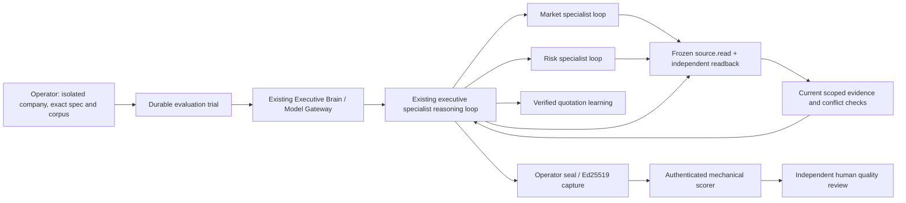

# Phase 8 independent review and offline acceptance

Baseline: `f9a007bf030763ee787d5bf0aeb8b8eaedc213af` on
`codex/sam-phase7-evaluation-infrastructure`. Candidate branch:
`codex/sam-phase8-independent-evaluation`. This is a fresh engineering review
of Phase 7, not a separate human security certification. PR #47 and its source
branch are preserved; this candidate requires its own review.

## Reproduced defects and corrections

| Finding | Reproduction and impact | Correction / regression |
| --- | --- | --- |
| Canonical JSON omitted own `__proto__` properties | Adding such a property to a real signed capture after signing still authenticated and scored PASS without the private key | `stableJson.ts` uses a null-prototype accumulator; regression proves unsigned insertion fails authentication and every JSON key participates in hashing |
| Agent deadline checked at reservation but omitted at invocation | Reserve a model ticket under a 50 ms agent limit, wait 100 ms, then `begin`: baseline admitted it while trial remained active | `trial.ts` rechecks the ticket's agent at execution admission; `tests/evaluation/budgets.ts` fails before the correction and passes afterward |
| Completed or mismatched tickets could reach invocation | A failed, never-invoked reservation could subsequently begin; provider/model metadata were not bound to the reservation | `begin` rejects finished attempts and binds provider, model, capability and work-goal metadata. `finish` rejects successful completion without invocation. Budget regressions cover these boundaries |
| Signed trace accepted malformed accounting and attempt transitions | A valid signing key could attest missing/string global counters, extra reservation counters, unknown kinds, success without invocation, invocation after completion, kind mismatch, agent-expired invocation and non-boolean seal flags | `trace.ts` checks exact finite counter shapes, kind/charge consistency, invocation ordering/binding, agent deadline and completion state; eleven hostile signed fixtures in `tests/evaluation/review.ts` |
| Mutually contradictory final claims became VERIFIED | Real executive/kernel/PG fixture run returned two different values for the same topic, each independently cited. Root reached COMPLETED with latest verification VERIFIED; the new rejection assertion failed | `engine.ts` rejects contradictory final claims both before accepting a report and in its independent verifier. Each of the three commercial orchestration tests reproduces and then recovers from the rejected proposal |

Before/after failure logs are retained under the local Phase 8 development
evidence directory. Ordinary JSON hashes remain unchanged. Hashes/signatures of objects with previously
omitted own `__proto__` fields deliberately change: quarantine and reverify such
legacy evidence; do not rewrite receipts or silently trust old signatures.

A valid signature proves the named operator signed bytes;
it never substitutes for accounting, source validation or semantic review.
The manufactured signed-trace attacks assume a defective or dishonest signer;
they are not claims that an untrusted model acquired the signing key.

## Implemented evaluation path



`scenarioRuntime.ts` builds only capabilities/configuration for the existing
composition. It introduces no executive engine, provider routing logic or
answers. All source access uses the registered, read-only frozen adapters.
All trial, family and agent limits continue to reserve before execution;
failed/uncertain attempts retain their charges. All published migrations and
migration receipts are unchanged. No new dependencies or deployment services.

`scenarios.ts` adds three synthetic corpora: unfamiliar heat-storage services,
laboratory-sleeve profitability, and membrane-cartridge suppliers. Source
publishers, dates and conflicting observations are supplied, with no expected
recommendation or required tool sequence. Frozen freshness is relative to the
explicit `2026-10-22` observation date, not a claim of current market freshness.
Old Phase 6 answer-key benchmarks remain legacy regression fixtures; they are
not used to score these new commercial scenarios.

For the commercial profile, claims bind topic/value to the canonical source's
`topic`/`value`, or an exact primitive sourceData field name. Transport metadata
and unrelated repeated numbers cannot verify an assertion. Calculations and
recommendations remain in the inference summary and require human assessment;
they do not become verified facts or automatically alter policies.

`scenarioScore.ts` checks the authenticated final root, all receipts including
unused ones, every citation (not only the first), fresh canonical source bytes,
company scope, successful source execution plus independent readback, distinct
specialist planning/report turns, actual delegation and multi-source synthesis,
conflict follow-up, bounded usage, uncertainty and verified learning ancestry.
Repeated observations of the same conflict are grouped by topic/values/citations
at their first detection; a repeated polling event does not invalidate an
already completed corrective read. No scorer contains a preferred recommendation. Reproducibility means the same
source/spec/code and acceptance rules; trial UUIDs, signatures, execution times
and event hashes intentionally differ between runs.

## What the tests establish

Run from a clean committed checkout:

```sh
npm run verify:full
npm run evaluate:specialists -- prepare-commercial --commit "$(git rev-parse HEAD)" --output /tmp/sam-commercial-protocol
npm run evaluate:specialists -- score-authenticated --commit "$(git rev-parse HEAD)" --input SIGNED_TRACE --trusted-key TRUSTED_PUBLIC_PEM --output NEW_SCORE_DIRECTORY
```

The full runner now has **53 required stages**, preserving all previous 49 and
adding independent trace review and one actual orchestration stage per new
scenario. Reports record exact commands, commit, time, runtime/image versions,
per-stage outcomes and hashes. The metadata directory additionally contains
three signed commercial captures, public fixture keys, mechanical scores,
negative-case results and reproducible protocols. Signing private keys are
in-memory test keys and are never exported.

The three tests use an explicitly scripted fixture provider. The actual
Executive Brain, PostgreSQL, specialist reasoning loop, concurrent delegation,
Kernel verification and learning execute; the provider decisions are simulated.
Each case tests two concurrent specialists, rejected stale/hostile sources,
replanning, ungrounded and contradictory report rejection, corrective reading,
executive synthesis and quotation learning. Thirteen signed negative cases per
scenario cover invalid fields/values, missing and secondary invalid citations,
contradictions, stale evidence, failed readback, foreign scope, detached learning
missing/foreign-root delegation, forged source bytes and absent conflict correction. These are architecture and mechanical acceptance
checks, not genuine model intelligence. Real SIGKILL recovery, database restart,
unknown reservations and tenant fences remain mandatory existing stages.

See the generated final acceptance report for actual results and exact final
commit; this document describes the implementation and does not predeclare a pass.
See [security review](PHASE8_SECURITY_REVIEW.md) and
[owner-gated live protocol](PHASE8_LIVE_EVALUATION_PROTOCOL.md) for remaining gates.
