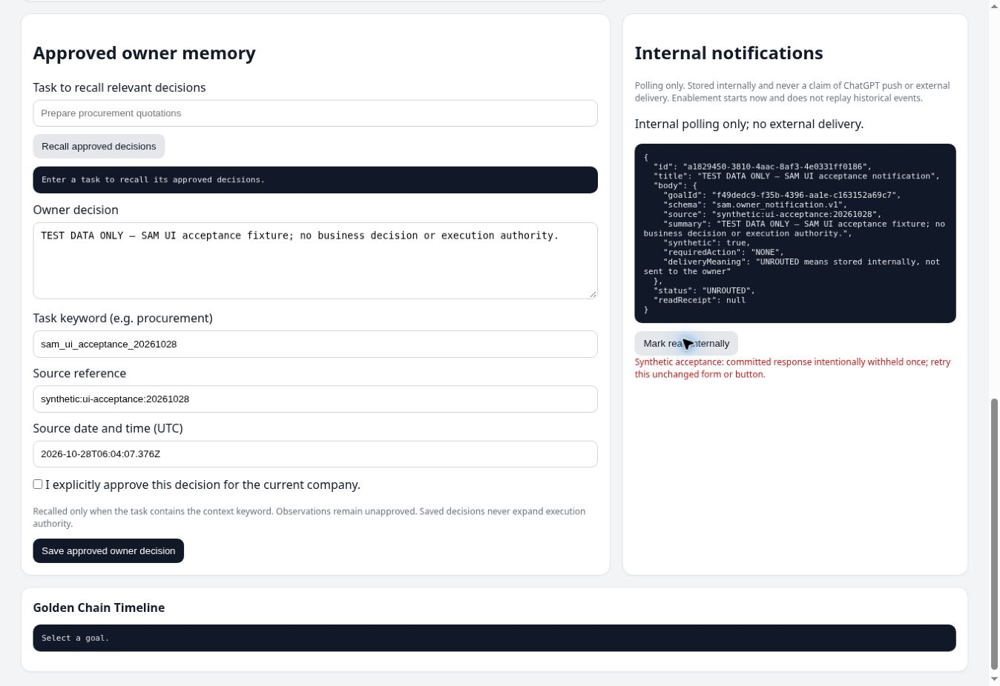
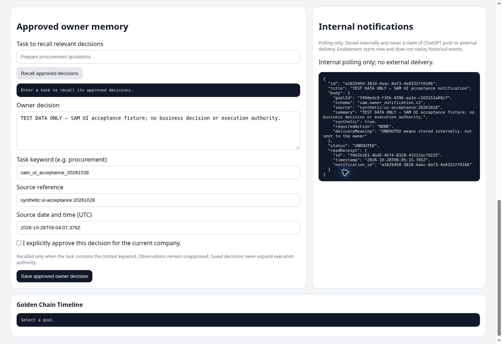

# SAM UI and ChatGPT connection acceptance — final scoped delivery

Requested acceptance is closed. Production remains usable at https://sam-command-center.onrender.com/ with CC/MCP application1e4e21a773c88e2366915edd3bb2e307fddaa157 and unaffected Runtime62ccbdbb94e080f22425f64396c894270ee551aa. PR86 remains Draft/open/unmerged. Reviewed notification-test correction6d84f8ca was deployed within source d8530ded08016af4d0225d2948d207e18dcd3b6a to the existing isolated test service only; that service is now SUSPENDED. No production redeployment or main integration occurred.

| Acceptance | Result | Evidence and practical limit |
| --- | --- | --- |
| Actual ChatGPT discovery and read invocation | PASS | Actual tool refresh, actual registry and calls to get_report (both saved reports), memory_status, recall_memory, notification_status and list_notifications. chatgpt-discovery-acceptance-20261028.json. |
| Authenticated production UI historical and mail report reads | Prior PASS retained | Same currently deployed1e4e21a; cc-authenticated-ui-acceptance-20261028.json / cc-auth-diagnosis-20261028.md. Original IDs/hashes/limits retained; no new analysis/mail recovery. |
| Actual isolated browser memory save/relevant recall/exclusion/retry | PASS at9005b022 | Explicit synthetic approval/source/date/context, recorde7beb6ae-ea5c-496b-9567-d84041ffd5fd. Correct context returns it; unrelated context returnsnone. Same unchanged-form retry leaves1row/1saveaudit. isolated-ui-memory-acceptance-20261028.json. |
| Scope isolation | PASS within observed channels | Private enrolled test company2796e0d9-1701-4e53-a7ac-d198c0e44c01, wrong-task browser exclusion and production ChatGPT recall empty. No second-company browser switch/session was tested. |
| Actual synthetic notification display and button acknowledgement/retry | PASS atd8530ded | Noticea1829450-3810-4aac-8af3-4e0331ff0186 linked to existing synthetic startupgoalf49dedc9-f35b-4396-aa1e-c163152a69c7. Two actual button clicks across disclosed first committed-response withholding yield one durable receiptf0d1b181-4bd5-4b74-8328-41511ac70225. Status remainsUNROUTED. |
| Existing service shutdown within authorized duration | PASS, independently confirmed | Resumed06:01:28.265Z, LIVE06:03:27.639Z, suspended06:06:06.369Z:4m38.104s includingbuild, below8min. Same0.5c512mb; no new plan/resource. |

Native restricted-role CLI is an adjunct, not browser proof. After browser acknowledgement retry it reported memoryCount1/save_audits1/read_receipts1, notificationUNROUTED, modelCalls0 and pushPerformedfalse. No successful memory test was repeated. The real production notificatione0283121-947e-47b9-94e7-8be1aae16299 remainsUNROUTED/readReceiptnull; actual production ChatGPT read confirms the synthetic notice is invisible in that scope.

Exact live proof: isolated-ui-notification-acceptance-20261028.json. Independent observer confirmed Render version/plan/lifecycle and visually reviewed the saved screenshots/JSON hashes without findings: notification-live-independent-closeout-20261028.json. Browser interactions and native counts are root-observed; they were not independently replayed. Code amendment separately passed independent Quick/security review, notification6/6 plus selectedexistingseednegative1/1, deployment compilation and diffcheck; see notification-amendment-independent-verification-final-20261028.json. Earlier failures remain historical evidence and were not rewritten as successes.

## Use now

From ChatGPT, ask to retrieve saved report1ed20021-9b0d-47f8-904b-cd72e3d0846f without execution, retrieve saved diagnostic3ccab2cc-ed84-4534-9c17-70c9271b5e06, recall approved owner decisions for the relevant task, or list internal notifications. Original report hashb7f7602baf275cc8c2a604e230859b22477c99fab64ec1f11f24d66cd6031de7 and historical narrative limits remain; diagnostic hash6e6d9abe3e11f1fc92653f952d283987ba409d5c2240a47e8c3a6ef59adad97e retains first-page/mailbox/window limits. These reads do not invoke a model or duplicate a report.

In the production Command Center use the existing bearer through its secure login, open saved goal/report cards, and use Approved owner memory with an explicit source/date/task context and owner approval. Internal notifications show their transport state and separate read receipt. No owner business decision or real-notification read receipt was fabricated for testing. Leave the isolated service suspended and preserve its clearly labelled fixtures/audits.

## Limits and remaining work

No owner action remains for this acceptance scope. ChatGPT push is unavailable/unproven; working delivery is internal UI polling plus actually discovered ChatGPT reads. UNROUTED means stored internally, even after internal acknowledgement. General source/execution knowledge remains FEATURE_DISABLED and engineering BMAD memory remains a separate Git system; this does not negate the accepted owner-decision path.

Earlier parallel MCP notification/recall errors were preserved; identical serialized retries succeeded. Their root cause remains UNKNOWN, so this acceptance does not assert permanent absence of transient failures. Further diagnosis would require correlated nonsecret client/server failure evidence under a separate focused reliability task, owned by SAM engineering. No speculative cold-start/grant/configuration repair was performed.

No broader readiness, new external automation, additional resources, credential/grant/RLS changes, paid model analysis or main integration is implied. The original historical report and completed mail goal/evidence remain immutable.

Final scoped secret scan covered all8 changed/new deliverables, excluding repository history/dependencies. The sole finding is the exact preexisting public boolean configuration/audit-line false positive at completion-progress.md:54, previously reproduced on baseline. No new secret finding or rule suppression; screenshots were also visually checked and contain no credentials.
